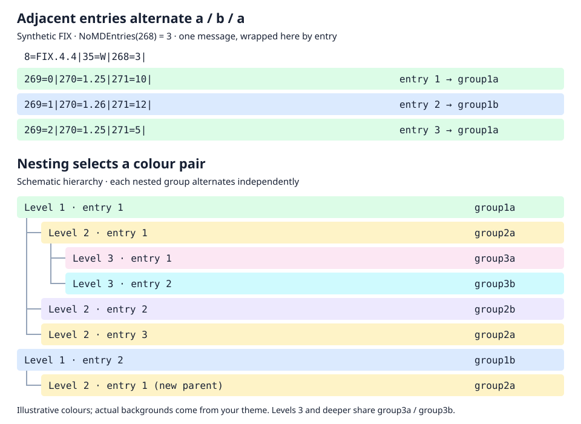

# venue-reader.nvim

An optional Neovim adapter for the [Venue Reader language server](https://github.com/sergluka/venue-reader).
Requires Neovim 0.12+. The server also works with Neovim's native LSP client
without this plugin.

The plugin reuses or installs the server, renders message summaries and adds
decoded yank and dictionary helpers. Hover, diagnostics, code actions, document
symbols, field hints and semantic highlighting use Neovim's native LSP support.
Optional Tree-sitter adds base highlighting, SOH conceal and structural selection
and navigation. It is not required for LSP features.

## Installation

Choose one method. The repository is currently private; GitHub access is required.

### LazyVim

Create `lua/plugins/venue-reader.lua`. LazyVim calls setup through `opts`:

```lua
-- lua/plugins/venue-reader.lua
return {
  {
    "sergluka/venue-reader.nvim",
    dependencies = { -- optional
      { "nvim-treesitter/nvim-treesitter", branch = "main" },
      { "nvim-treesitter/nvim-treesitter-textobjects", branch = "main" },
    },
    opts = {},
  },
}
```

The optional dependencies use Tree-sitter `main` APIs; ensure your LazyVim
configuration uses those APIs. The inner spec also works with standalone
lazy.nvim. Remove `dependencies` if you do not need them.

### Native Neovim package manager

Add to `init.lua`:

```lua
-- init.lua
vim.pack.add({
  {
    src = "https://github.com/sergluka/venue-reader.nvim",
  },
})
require("venue-reader").setup()
```

Update with `:lua vim.pack.update({ "venue-reader.nvim" })`.

Server discovery starts with a named FIX buffer. It reuses a compatible explicit
command, PATH binary or managed installation, in that order. Otherwise it installs
the [pinned server](lua/venue-reader/release.json) asynchronously, checking SHA-256.
An invalid explicit command reports an error. Compatible installations are reused
without automatic upgrades or PATH changes.

Linux automatic artifacts require x86_64/glibc >=2.35. macOS and Windows artifacts
are listed in the manifest, but native validation there remains outstanding.
Installation tools and manual/offline setup are described in
[Installation](https://github.com/sergluka/venue-reader.nvim/wiki/Installation)
and `:help venue-reader-setup`.

## Configuration

Defaults work with `setup()`. For example, choose summaries above messages and
pass server settings through `settings.fix`:

```lua
require("venue-reader").setup({
  summary = { mode = "above" },
  settings = { fix = {
    inlayHints = {
      tagNames = { enabled = true },
      enumValues = { enabled = true },
    },
  } },
})
```

For an existing binary or offline use:

```lua
require("venue-reader").setup({
  server = {
    cmd = { "/absolute/path/to/venue-reader", "--stdio" },
    auto_install = false,
  },
  treesitter = { enabled = false },
})
```

`server.cmd` is an argv list; its executable must support `--version`. Project
and modeline settings keep precedence. Settings update on repeated setup;
executable changes require `:VenueReader restart`. See
[plugin configuration](https://github.com/sergluka/venue-reader.nvim/wiki/Configuration),
`:help venue-reader-setup` and the server's
[settings reference](https://github.com/sergluka/venue-reader/wiki/Configuration-Reference).

## First use

Open a `*.fix` file, or use `:set ft=fix`. LSP attachment requires a normal buffer
with a name; `:file /path/log.fix` assigns one without saving. Buffers share a
client under the nearest `.venue-reader.toml` root, otherwise their directory.

Use native LSP interfaces, for example `:lua vim.lsp.buf.hover()` and
`:lua vim.lsp.buf.document_symbol()`. The plugin sets no user keybindings.

| Command | Purpose |
| --- | --- |
| `:VenueReader status` | Inspect server, annotations and optional grammar state |
| `:checkhealth venue-reader` | Check requirements and current state |
| `:VenueReader restart` | Resolve the executable and restart through native LSP |
| `:VenueReader install server` | Retry server discovery/installation |
| `:VenueReader install grammar` | Retry optional FIX parser acquisition |
| `:VenueReader dictionary` | Choose a server dictionary with `vim.ui.select` |
| `:VenueReader settings` | Preview effective settings, sources and warnings |
| `:VenueReader tag 54 1` | Look up `Side(54) = 1` |

Decode the field under the cursor with `:VenueReader yank`, or lines with
`:10,20VenueReader yank a`, then paste normally with `p`/`P`. For a decoded
Normal/Visual operator, add:

```lua
vim.keymap.set({ "n", "x" }, "<leader>y", "<Plug>(VenueReaderYank)")
```

Motions, textobjects, counts and repeat use Neovim's native operator support.
Register behavior and character/line/block selections are documented in
[Commands](https://github.com/sergluka/venue-reader.nvim/wiki/Commands)
and `:help venue-reader-commands`.

## Summaries and highlighting

Choose a mode with `:VenueReader summary above`, or set `summary.mode`:

| Mode | Display | Styling |
| --- | --- | --- |
| `front` (default) | Inline before the raw message | `VenueReaderSummary` |
| `above` | Virtual line above the message | Same custom styling as front |
| `codelens` | Native CodeLens above the message | `LspCodeLens` |
| `off` | No summary | Other LSP features remain available |

The server supplies the same summary text/details through either channel.
Custom modes currently use one summary highlight. Native field hints use
`LspInlayHint`; semantic highlights can alternate backgrounds for repeating-group
entries while preserving field foregrounds.



The plugin respects server processing limits. Oversized native inlay requests can
omit summaries and field hints; CodeLens and semantic responses have separate
limits. The plugin does not split requests, scan FIX text or recover omitted
results. See [Summaries](https://github.com/sergluka/venue-reader.nvim/wiki/Summaries)
and [Highlights](https://github.com/sergluka/venue-reader.nvim/wiki/Highlights),
or `:help venue-reader-modes` and `:help venue-reader-styling`.

## Optional syntax and documentation

If a working FIX Tree-sitter parser is already installed, the plugin uses it
without downloading or rebuilding it. Otherwise installation can use
nvim-treesitter `main`; a missing manager, toolchain or failed download leaves
LSP available. Tree-sitter does not decode messages or extend server limits.

See [Tree-sitter](https://github.com/sergluka/venue-reader.nvim/wiki/Tree-sitter)
and `:help venue-reader-treesitter` for SOH conceal, selection, explicit
field/message navigation mappings and large-file policy.

Start with `:help venue-reader` for the full offline guide, including setup,
commands, annotations, syntax, troubleshooting and development. The
[help index](doc/venue-reader.txt) links its topic files.

The wiki is prepared in the sibling `venue-reader.nvim.wiki` repository.
Its [online pages](https://github.com/sergluka/venue-reader.nvim/wiki/Home) will
become available after publication, when the project is public. Until then,
read that checkout locally or use the bundled help.

Development commands and platform acceptance status are in
[Contributing](https://github.com/sergluka/venue-reader.nvim/wiki/Contributing),
`:help venue-reader-development` and [tests/ACCEPTANCE.md](tests/ACCEPTANCE.md).
